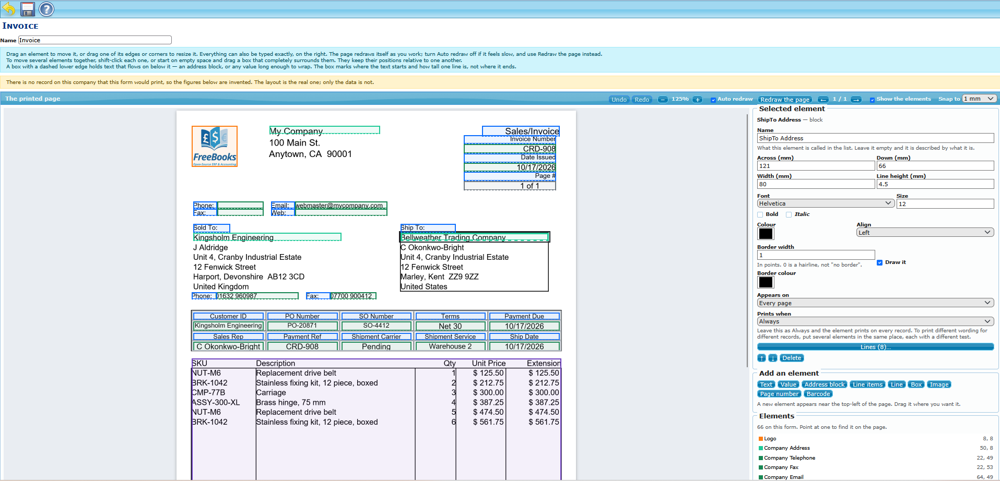
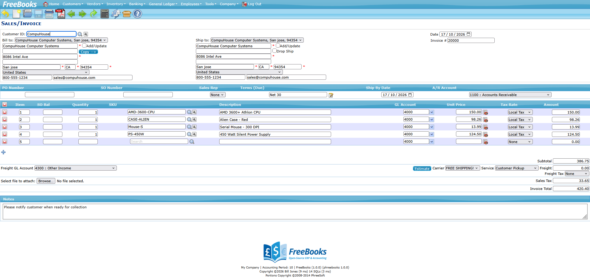
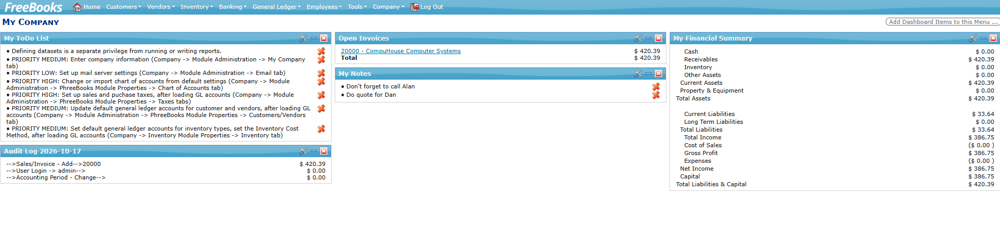

# FreeBooks

**Accounting and business management you own.**

FreeBooks is a complete, open-source accounting and ERP system for small businesses: double-entry
books, invoicing, purchasing, inventory and point of sale in one web application. You run it on your
own server, a small cloud machine or your desktop. There is no subscription, no per-user fee, and
nobody else holding your records.

It is built on the proven foundations of PhreeBooks 3.7.1 and has been modernised throughout: current
PHP and MySQL/MariaDB, a Bootstrap interface, a new document designer, and a published
container image that runs anywhere Docker does.



## What it does

- **Complete books.** General ledger, receivables and payables, bank reconciliation, budgets,
  multi-currency, VAT and sales tax, year-end close, and a full set of financial reports.
- **Sell.** Quotes, sales orders, invoices, credit memos, customer statements and collection
  letters. A browser-based point of sale with card-terminal support, and payment links your
  customers can pay online.
- **Buy.** Purchase quotes and orders, receiving, supplier invoices in the supplier's own currency,
  and payments.
- **Inventory that adds up.** Stock, serialised and non-stock items, assemblies and product bundles,
  with FIFO, LIFO or average costing kept in step with the ledger.
- **Ship from the order.** Partial shipments, packing lists and carrier labels, with built-in
  DHL Express and Royal Mail support and further carriers available.
- **Your documents, your way.** A visual designer for invoices, statements, labels, receipts and
  reports: drag, resize and preview on the real page.
- **Many companies, many users.** Each company in its own database, roles and permissions per user,
  and passkey (passwordless) sign-in.
- **Connects when you want it to.** Optional modules synchronise a Zen Cart store and export to
  Xero and QuickBooks Online.
- **Yours to change.** Open source under the GPL, with a drop-in customisation layer so local
  changes survive upgrades.




## New since PhreeBooks

If you know PhreeBooks 3.7.1, the headline changes are:

- **Forms replaces PhreeForm**: a visual designer, a reporting catalogue that no report can use to
  reach tables it should not, and your existing reports and forms carried over.
- **Runs on today's software**: PHP 8, MySQL 8 and strict-mode MariaDB, with every page reworked
  in Bootstrap and jQuery UI gone.
- **Security hardened throughout**: SQL injection, cross-site scripting and request-forgery
  protection, stored card security codes removed, and passkey sign-in.
- **New business features**: supplier currencies, payment links, card terminals, partial
  shipments, product bundles, DHL Express and Royal Mail, and a company time zone.
- **A published container image**, so installing is one command.

The [release notes](https://github.com/billj9000/freebooks/releases) list every change.

## Requirements

| | |
|---|---|
| PHP | 8.2 or later (8.x). Extensions: `pdo_mysql`, `mbstring`, `curl`, `openssl`, `gd`, `zip`, `bz2`, `session` |
| Database | MySQL 8.0 or later (tested on 8.4), or MariaDB 10.6 or later (tested on 11.4) |
| Web server | Apache 2.4 with `mod_rewrite` and `AllowOverride All` |
| Browser | Any current browser |

HTTPS is recommended, and is required for passkey sign-in.

The installer checks PHP and its extensions before it starts. Docker users need none of this: the
image contains everything except the database, which the Docker setup provides.

## Installing with Docker (recommended)

The quickest route on Linux, Windows and macOS alike. The published image,
`ghcr.io/billj9000/freebooks`, runs on both x86 and ARM machines. The
[freebooks-docker](https://github.com/billj9000/freebooks-docker) repository holds a ready-made
Docker Compose setup with a database alongside it.

1. Install [Docker](https://docs.docker.com/get-docker/) (Docker Desktop on Windows and macOS).
2. Get the Compose setup and choose your database passwords:

   ```bash
   git clone https://github.com/billj9000/freebooks-docker
   cd freebooks-docker
   cp .env.example .env      # then edit .env
   ```

3. Start it:

   ```bash
   docker compose up -d
   ```

4. Open http://localhost. A new installation goes straight to the installer, with the database
   details already filled in from `.env`.

Company data and settings live in Docker volumes, so they survive restarts and upgrades. Once
FreeBooks is installed, the container closes the installer to the web every time it starts.

The freebooks-docker README covers updating to a new release, HTTPS behind a reverse proxy, and
running on Fly.io.

## Installing on your own web server

1. Create an empty database:

   ```sql
   CREATE DATABASE freebooks CHARACTER SET utf8mb4 COLLATE utf8mb4_unicode_ci;
   ```

2. Copy the contents of `trunk/` to the web root, and make `my_files/` and `includes/` writable by
   the web server user.
3. Open `/install/` in a browser and follow the installer. It creates the first company, its
   administrator, and a starter chart of accounts (US, UK or Ireland).
4. Remove the `install/` directory, or deny web access to it. The installer refuses to run once
   FreeBooks is configured, but the directory should not stay reachable.
5. Schedule the daily currency-rate update if you use more than one currency (see
   [Scheduled tasks](#scheduled-tasks)).

**Apache only.** FreeBooks keeps its configuration, company files, backups and logs out of reach of
the web with `.htaccess` files in `includes/`, `modules/`, `my_files/`, `cron/` and `themes/`.
Nginx ignores those files. Running behind Nginx is possible only if you reproduce those rules in its
configuration, and it has not been tested.

### The site address

The installer records the address it was run on (`HTTP_SERVER` in `includes/configure.php`, or
`config/configure.php` in Docker), and FreeBooks builds its links and its login form from it. If you
later reach FreeBooks at a different hostname or port, change `HTTP_SERVER` to match, or logins will
be sent to the old address and refused with "Invalid request token". Behind HTTPS, also set
`ENABLE_SSL_ADMIN` to `'true'`.

## Upgrading

**From an earlier FreeBooks release:** take a backup, install the new release over the old one
(with Docker, change `FREEBOOKS_VERSION` and pull), and log in. The database is brought up to date
when an administrator next logs in to each company.

**From PhreeBooks 3.7.1:** deploy FreeBooks over the existing installation, keep the existing
`includes/configure.php` and `my_files/`, and log in. The schema is brought up to date on the first
login, and the modules record the new version as they go.

Take a backup first. The upgrade is designed to be safe to re-run if it stops part way, because every
step checks whether it has already been applied, but a backup is the only thing that undoes a
decision you would rather not have made.

PhreeForm is replaced by **Forms**, which the upgrade installs. Existing reports and forms carry over
as they are. Anyone who could use PhreeForm can run and write reports in Forms; permission to define
datasets (which tables a report may join) is new, and an administrator grants it under
Company → Roles.

Older PhreeBooks releases are not supported directly. Upgrade to 3.7.1 with PhreeBooks' own updater
first, then to FreeBooks.

## Optional modules

`extensions/` holds optional components that are not part of a standard installation: modules such
as Work Orders, Assets, RMA, Zen Cart, Xero Sync and QuickBooks Sync; further shipping and payment
methods; dashboards, report templates and language packs.

**On your own web server**, copy a module into place and install it for each company under
Company → Modules:

| Component | From | To |
|---|---|---|
| Module | `extensions/Modules/<name>/` | `modules/<name>/` |
| Shipping method | `extensions/ShippingMethods/<name>/` | `modules/shipping/methods/<name>/` |
| Payment method | `extensions/PaymentMethods/<name>/` | `modules/payment/methods/<name>/` |

Zen Cart is laid out differently: its FreeBooks module is
`extensions/Modules/zencart/PhreeBooksFiles/modules/zencart/`, and its own README explains the parts
that run on the Zen Cart side.

**With Docker**, build a small image of your own on top of the published one, so the additions
survive the container being recreated. From a checkout of this repository:

```dockerfile
FROM ghcr.io/billj9000/freebooks:1.0
COPY extensions/Modules/work_orders/ /var/www/html/modules/work_orders/
COPY extensions/ShippingMethods/ups/ /var/www/html/modules/shipping/methods/ups/
```

Then run that image in place of the published one; the freebooks-docker README shows how.

## Scheduled tasks

`trunk/cron/` holds the command-line scripts that run on a schedule. Each explains its options in
its header comment.

| Script | What it does |
|---|---|
| `update_currency_rates.php` | Updates exchange rates from the European Central Bank. Daily. |
| `zencart_sync.php` | Imports new Zen Cart orders. Needs the Zen Cart module. Every 15 minutes. |

**On your own web server**, add them to the system crontab, as the web server user:

```
0 1 * * *    php /path/to/webroot/cron/update_currency_rates.php
*/15 * * * * php /path/to/webroot/cron/zencart_sync.php
```

**With Docker**, the image already runs the currency update. To add a task, put a crontab file into
your own image (see [Optional modules](#optional-modules)):

```dockerfile
COPY my-tasks /etc/cron.d/freebooks-extra
```

using the same format as the image's own `/etc/cron.d/freebooks`: a user name before the command,
and output sent to `/proc/1/fd/1` so that it appears in `docker logs`:

```
*/15 * * * * root php /var/www/html/cron/zencart_sync.php >> /proc/1/fd/1 2>&1
```

## Backups

A company is its database plus its folder in `my_files/` (attachments, images, document
definitions). Tools → Company Backup downloads both. With Docker, the `config` and `my_files`
volumes and the database volume are everything there is to keep.

## Printing labels and receipts

Labels and receipts print through the browser's normal print dialog, with nothing to install. For
printing straight to a thermal printer (Zebra and similar) without the dialog, install
[QZ Tray](https://qz.io/download/) on that workstation and allow it when the browser first asks.
Without a signing certificate, also enable **Allow unsigned** in QZ Tray's preferences.
Each shipping method and POS till then has a **Printer Name** setting: use the printer's exact name
as the operating system shows it. Without QZ Tray, printing falls back to the dialog on its own.

## Languages

English (US and UK) and Dutch are complete. Portuguese (Brazil) and Russian are partly translated,
and fall back to English where a translation is missing. Further language packs from earlier
releases are in `extensions/LanguagePacks/`.

## Logs

FreeBooks writes three logs to `my_files/`: `errors.log` (PHP warnings and errors), `sql_errors.log`
(statements the database refused) and `empty_column_writes.log` (blank values written to columns
that cannot hold one). Each rotates at 8 MB, keeping one previous file. To change the size, add
`define('LOG_MAX_BYTES', <bytes>);` to `configure.php`; `0` lets a log grow without limit.

## Documentation and help

FreeBooks has a built-in manual covering setup, daily use and administration, and the Help button
on a page opens the topic for it. Questions, bug reports and suggestions are welcome as
[GitHub issues](https://github.com/billj9000/freebooks/issues).

## Licence and credits

FreeBooks is free software, released under the GNU General Public License version 3 or later; see
[LICENSE](LICENSE).

FreeBooks began as PhreeBooks 3.7.1 by PhreeSoft, whose work remains the foundation of this one.
Bundled third-party libraries keep their own licences.
